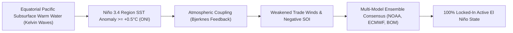
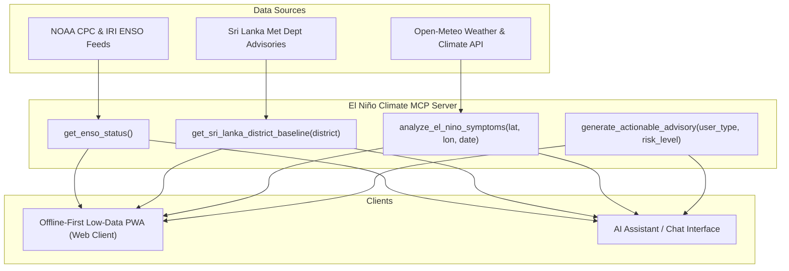

# Sri Lanka El Niño Alert & Climate Impact System (SLEnS)
### Complete Scientific Analysis, MCP Architecture, and Offline-First PWA Implementation Blueprint

---

## 1. Scientific Basis: How Scientists Determine El Niño with ~100% Certainty

When international bodies like **NOAA Climate Prediction Center (CPC)**, the **International Research Institute for Climate and Society (IRI)**, **WMO**, and the **Sri Lanka Department of Meteorology** declare near **100% probability**, this is not speculative weather forecasting. It indicates that the **ocean-atmosphere system has officially coupled and locked in**.

### Key Scientific Indicators Forecasters Use:
1. **Oceanic Niño Index (ONI)**:
   - Measures the 3-month running average of Sea Surface Temperature (SST) anomalies in the **Niño 3.4 region** ($5^\circ\text{N}–5^\circ\text{S}, 170^\circ\text{W}–120^\circ\text{W}$).
   - **Threshold**: Sustained anomaly of $+0.5^\circ\text{C}$ or greater for at least 5 consecutive overlapping 3-month periods defines an El Niño. Strong events exceed $+1.5^\circ\text{C}$ to $+2.0^\circ\text{C}$.
2. **Atmospheric Coupling (Bjerknes Feedback)**:
   - The ocean warms, shifting the Pacific Walker circulation eastward.
   - **Southern Oscillation Index (SOI)**: Measures the standardized sea-level pressure difference between Tahiti and Darwin (Australia). Persistently negative values confirm atmospheric locking.
   - **Trade Wind Anomalies**: Low-level equatorial easterlies weaken or reverse into westerlies.
3. **Subsurface Heat Content**:
   - Deep warm water anomalies (down to 300 meters) propagate eastward as downwelling oceanic Kelvin waves, physically guaranteeing that surface warming will persist for months.
4. **Multi-Model Dynamical & Statistical Ensembles**:
   - Over 20 global models (e.g., NOAA CFSv2, ECMWF SEAS5, UK Met Office GloSea6, Australia ACCESS-S2) run hundreds of ensemble simulations.
   - When all ensemble members sit above the threshold without divergence, forecasters report **100% probability for the season**.

---

## 2. El Niño's Dual Impact on Sri Lanka: Regional & Seasonal Symptoms

El Niño does not affect all regions of Sri Lanka equally throughout the year. Its effect depends strictly on Sri Lanka's **monsoon cycle and topography**.

| Season | Typical Months | El Niño Impact on Sri Lanka | High-Risk Districts & Zones | Primary Symptoms |
| :--- | :--- | :--- | :--- | :--- |
| **Southwest Monsoon (Yala)** | May – Sep | **Rainfall Deficit / Drought** (Monsoon suppression) | Western, Southern, Sabaragamuwa, Central, and Dry Zone paddies (Kurunegala, Anuradhapura, Hambantota) | Reservoir depletion, agricultural water rationing, prolonged dry spells, heat stress |
| **Second Inter-Monsoon (SIM)** | Oct – Nov | **Rainfall Normal to Above-Normal** | Island-wide | Heavy convective afternoon thunderstorms |
| **Northeast Monsoon (Maha)** | Dec – Feb | **Enhanced Rainfall / Flood Risk** | Northern, Eastern, North-Central (Batticaloa, Trincomalee, Polonnaruwa, Jaffna, Vavuniya) | Flash floods, overflow of major tanks/towers, crop waterlogging |
| **First Inter-Monsoon / Dry Transition** | Mar – Apr | **Elevated Temperatures / Heatwaves** | Island-wide (especially Northern, North-Western, and Eastern lowlands) | Extreme daytime highs ($+1.5^\circ\text{C}$ to $+3.0^\circ\text{C}$ above normal), high heat index |

### Algorithmic Symptom Detection Method (For App Logic)
To determine if an area is exhibiting **"El Niño Symptoms"**, the system evaluates:
$$\text{El Niño Symptom Score} = w_1 \cdot \Delta P_{\text{anomaly}} + w_2 \cdot \Delta T_{\text{anomaly}} + w_3 \cdot \text{ENSO}_{\text{state}} + w_4 \cdot \text{Seasonal\_Sign}$$
- **$\Delta P_{\text{anomaly}}$**: Current 30-day/90-day precipitation relative to the 30-year climatological baseline (ERA5 normal).
- **$\Delta T_{\text{anomaly}}$**: Temperature deviation from district baseline.
- **$\text{Seasonal\_Sign}$**: In Yala (May–Sept), negative precipitation anomaly matches El Niño; in Maha (Dec–Feb), positive precipitation anomaly in the East matches El Niño.

---

## 3. The Role of the MCP (Model Context Protocol) Server

An **MCP Server** acts as the intelligent bridge between raw climate data, LLMs, and client applications.

### Functions Provided by the Climate MCP Server:
1. `get_enso_status`:
   - Returns the latest Oceanic Niño Index (ONI), current Niño 3.4 SST anomaly, SOI index, and official probability distribution (e.g., El Niño 98%, Neutral 2%, La Niña 0%).
2. `get_district_climate(district_id)`:
   - Returns 30-year normal rainfall, typical monsoon breakdown, and historical sensitivity matrix to El Niño for that specific district.
3. `analyze_el_nino_symptoms(lat, lon, current_weather)`:
   - Cross-references real-time rainfall and temperature anomalies with historical El Niño patterns for the current calendar month.
   - Emits a structured diagnostic: `symptom_probability` (0–100%), `risk_category` (Severe Drought, Flood Risk, Heat Advisory, or Nominal), and `recommended_actions`.

---

## 4. Web Application Architecture: Online + Offline + Low-Data Mode

To serve users across Sri Lanka—including rural farmers and communities with limited 2G/3G connectivity:

### A. Offline-First PWA (Progressive Web App)
- **Service Worker (`sw.js`)**:
  - Pre-caches core app shell (HTML, minimal CSS, Vanilla/Preact JS bundle) on initial load ($< 150 \text{ KB}$).
  - Caches baseline climate data for all 25 Sri Lankan districts in **IndexedDB**.
  - Works 100% offline: If a user has no signal, they can still open the app, pick their district or view their last GPS coordinate, view the district's vulnerability profile, and read mitigation guidelines.
- **Background Sync**:
  - When connection is restored, the Service Worker silently fetches updated NOAA ENSO values and real-time 7-day weather observations.

### B. Low-Bandwidth Optimizations
- **Vector-First (No Heavy Map Tiles)**:
  - Avoid heavy raster map tiles (Google Maps / Mapbox raster tiles consume 5–15 MB).
  - Use an ultra-compact interactive SVG of Sri Lanka's 25 districts ($< 35 \text{ KB}$ gzipped).
  - Colors dynamically indicate risk status (Red = High Alert, Orange = Warning, Green = Normal).
- **JSON Payload Minification**:
  - Weather anomaly reports compressed into compact arrays instead of verbose JSON objects.
- **Data-Saver / Text Mode**:
  - A one-click toggle for an ultra-fast high-contrast text view ($< 20 \text{ KB}$ total transfer).

---

## 5. Technology Stack Recommendation

| Component | Recommended Tool / Library | Reason |
| :--- | :--- | :--- |
| **Frontend Framework** | **Vanilla HTML5/ES6** | Extreme speed, $< 30 \text{ KB}$ runtime, instant loading on low-end smartphones |
| **Styling** | **Pure CSS** | Low overhead, full responsive design |
| **Offline Storage** | **IndexedDB** | Stores district datasets and historical charts locally |
| **Climate & Weather API** | **Open-Meteo Climate & Weather API** | Free, open-source, no API keys, fast global coverage, includes historical normals |
| **ENSO Feed** | **NOAA CPC Public Data / IRI monthly JSON** | Official global source of truth for ONI and ENSO alerts |
| **Backend & MCP** | **Node.js JSON-RPC 2.0 Server** | Exposes both stdio and SSE MCP tools for AI pair programming |

---

## 6. Implementation Roadmap

1. **Phase 1: Climate Analysis Engine & Open Data Pipeline**
   - Ingest NOAA CPC ONI datasets & Open-Meteo precipitation/temperature anomalies for Sri Lanka.
   - Construct Sri Lanka's 25-district baseline matrix (Wet/Intermediate/Dry zones, Yala vs. Maha sensitivity).
2. **Phase 2: Climate MCP Server Development**
   - Build lightweight MCP server exposing `get_enso_diagnostic_state`, `analyze_sri_lanka_location_drought`, and `compare_district_climate_symptoms`.
3. **Phase 3: Ultra-Lightweight PWA Frontend**
   - Develop responsive interactive SVG map of Sri Lanka.
   - Configure Service Worker for seamless offline caching.
   - Implement GPS auto-detection with fallback manual district selector.
4. **Phase 4: Field Testing & Verification**
   - Audit with automated test suite and test server for 100% offline compliance.
