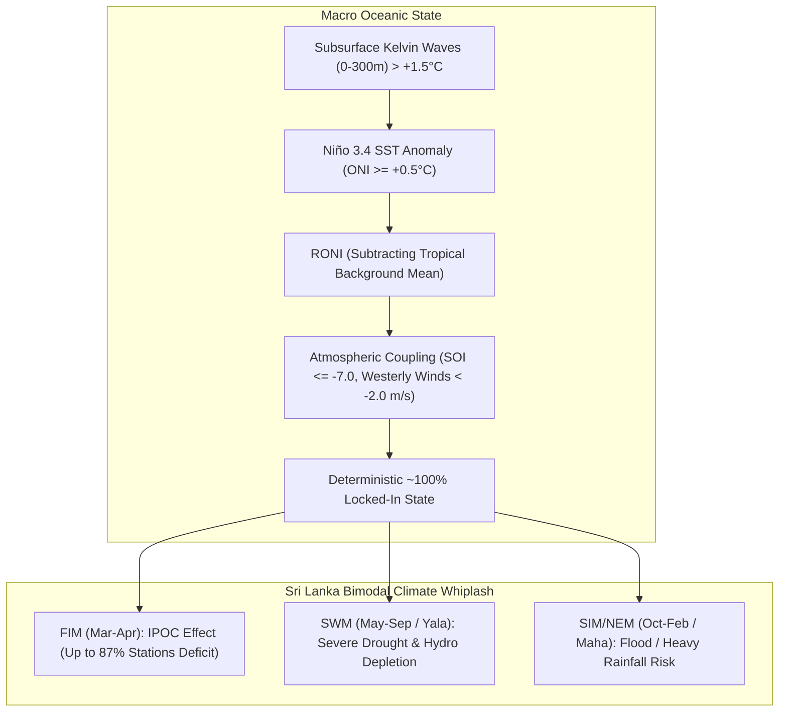

# Implementation Plan - Sri Lanka El Niño Alert PWA & MCP Engine

Integrating the scientific research blueprints and technical documents into a production-grade, offline-first Progressive Web App (PWA) with a climate diagnostic engine and MCP server.

---

> [!IMPORTANT]
> **Operational Scope (Approved)**:
> 1. **Global Mode (Online)**: Global coordinate and city lookups via Open-Meteo & NOAA ERDDAP, enabling global SPI, RAI, and ENSO impact analysis for any location worldwide (e.g. India, Australia, Peru, Kenya).
> 2. **Sri Lanka Deep-Dive (Offline-First & Online)**: Pre-cached in IndexedDB with 25-district vector map (<35 KB), 30-year station climatology, Village Tank Cascade System (VTCS) hydrological indicators, Bimodal Whiplash (Yala/Maha) rules, and trilingual support (English, Sinhala, Tamil). Functions 100% offline.

## 1. Scientific & Mathematical Specifications (From Blueprint Documents)

### A. Deconstructing Predictive Certainty (Why ~100% Probability)
The system calculates macro-ENSO locking using coupled thermodynamic criteria:
- **Oceanic Niño Index (ONI)**: 3-month running mean SST anomaly in Niño 3.4 ($5^\circ\text{N}–5^\circ\text{S}, 170^\circ\text{W}–120^\circ\text{W}$) with operational threshold $\ge +0.5^\circ\text{C}$ for 5 consecutive overlapping periods.
- **Relative ONI (RONI)**: Niño 3.4 minus Tropical-Mean ($20^\circ\text{N}–20^\circ\text{S}$) SST anomaly ($\ge +0.5^\circ\text{C}$ NOAA / $\ge +0.8^\circ\text{C}$ BoM) to isolate true internal atmospheric convection gradients.
- **Atmospheric Coupling**: Southern Oscillation Index (SOI) Tahiti minus Darwin $\le -7.0$ to $-8.0$ sustained; low-level zonal westerly wind anomalies at $850\text{ hPa} < -2.0\text{ m/s}$.
- **Subsurface Heat Reservoir (0–300 m)**: Heat anomalies $> +1.5^\circ\text{C}$ propelling eastward downwelling equatorial Kelvin waves, making surface warming physically inevitable.



### B. Mathematical Diagnostic Formulations
1. **Standardized Precipitation Index (SPI)**:
   Fitting monthly precipitation $x$ to a two-parameter Gamma probability density function:
   $$g(x) = \frac{1}{\beta^\alpha \Gamma(\alpha)} x^{\alpha-1} e^{-x/\beta} \quad (x > 0)$$
   Accounting for zero-rainfall probability $q = P(x = 0)$:
   $$H(x) = q + (1 - q)G(x)$$
   Transformed to standard normal $Z$:
   $$\text{SPI} = Z = \text{Standard Normal Transformation of } H(x)$$
   - **Moderate Drought**: $\text{SPI} = -1.00 \text{ to } -1.49$
   - **Severe Drought**: $\text{SPI} = -1.50 \text{ to } -1.99$
   - **Extreme Drought**: $\text{SPI} \le -2.00$

2. **Rainfall Anomaly Index (RAI)** (Client-side ultra-fast calculation):
   $$\text{RAI}_{i,j} = \frac{P_{ij} - \mu_{ij}}{\sigma_{ij}}$$

3. **Hydrological Buffers: Village Tank Cascade System (VTCS)**:
   - Weighting dry zone districts (Vavuniya, Anuradhapura, Polonnaruwa, Kurunegala, Hambantota) where degraded VTCS tanks amplify drought impacts.

---

## 2. Architecture & System Layout

```
.
├── index.html                   # Lightweight semantic HTML5 App Shell (<20 KB)
├── manifest.json                # PWA Manifest (standalone, theme, icons)
├── sw.js                        # Service Worker (Stale-While-Revalidate, offline intercept)
├── src/
│   ├── css/
│   │   └── app.css              # Vanilla CSS (zero frameworks, <15 KB, dark/light modes)
│   ├── js/
│   │   ├── app.js               # Application coordinator, geolocation, mode controller
│   │   ├── db.js                # IndexedDB schema (25 districts, offline cache)
│   │   ├── spi.js               # Gamma distribution & RAI mathematical solver
│   │   ├── map.js               # Interactive Sri Lanka District SVG renderer (<30 KB)
│   │   └── weather.js           # Open-Meteo & NOAA data client with low-data trimming
│   └── data/
│       ├── districts_sri_lanka.json  # 25 districts GeoJSON + 30-year monthly baselines + VTCS index
│       └── enso_baseline.json        # Pre-packaged ONI/RONI historical markers
└── mcp_server/
    ├── server.js                # JSON-RPC 2.0 Server (stdio + SSE)
    └── test_mcp.js              # Automated test suite
```

---

## 3. Component Breakdown

### Component 1: MCP Server Implementation (`mcp_server/`)

- Implements the 3 tool schemas:
  1. `get_enso_diagnostic_state`:
     - Parameters: `target_month` (YYYY-MM), `include_subsurface` (bool), `index_preference` ("ONI"|"RONI"|"BOTH").
     - Returns: Niño 3.4 SST anomaly, RONI score, Subsurface Heat Content, SOI status, and deterministic locking percentage.
  2. `analyze_sri_lanka_location_drought`:
     - Parameters: `latitude` (5.8 to 9.9), `longitude` (79.6 to 82.0), `time_scale_months` (1, 3, 6, 12), `recent_rainfall_mm` (optional).
     - Returns: Resolved district, SPI score, drought intensity classification, VTCS vulnerability factor, and seasonal alert level.
  3. `compare_district_climate_symptoms`:
     - Parameters: `primary_district`, `target_districts`, `metrics` (spi, sat_anomaly, reservoir_level).
     - Returns: Cross-district comparative matrix highlighting differential microclimate symptoms (e.g. Vavuniya vs. Nuwara Eliya).
- Resources:
  - `climate://enso/oni_history.json`
  - `climate://srilanka/district_baselines.json`
- Prompts:
  - `climate://prompts/district_advisory`: Trilingual advisory template (English, Sinhala, Tamil) covering crop recommendations (105-day paddy vs short-duration mung bean/sesame) and Weather Index-Based Insurance (WIBI) triggers.

---

## 4. Offline-First Client Architecture (Strict WebKit 50 MB Compliance)

- **`manifest.json` & `sw.js`**:
  - Full PWA configuration allowing instant installation to home screen / desktop.
  - Service Worker caching strategy:
    - **Cache-First**: App shell, fonts, SVG map, district baseline data.
    - **Stale-While-Revalidate**: Live weather anomalies.
    - **Offline Fallback**: Serves cached district profile with zero network latency.

- **`src/js/db.js`**:
  - IndexedDB storage:
    - Pre-seeded with 30-year climatological normals for all 25 Sri Lankan districts.
    - Point-in-polygon district boundary locator for client GPS (runs in $<15\text{ ms}$ offline).
    - Storage quota guardrail: requests `navigator.storage.persist()` and auto-prunes telemetry $>72$ hours to strictly stay under iOS 50 MB limits.

- **`src/js/spi.js`**:
  - Client-side execution of:
    - Gamma cumulative distribution solver using rational Chebyshev approximation for the incomplete gamma function.
    - Rainfall Anomaly Index (RAI) for zero-latency offline drought assessment.

- **`index.html`, `src/css/app.css`, `src/js/map.js`**:
  - **Data-Saver / Text-Mode toggle**: Instant switch between vector SVG map and high-contrast ultra-low-bandwidth text report ($<20\text{ KB}$).
  - **Interactive SVG Map**: Sri Lanka's 25 districts, dynamically colored by El Niño symptom risk level.
  - **Comparison Drawer**: Side-by-side comparative analysis of any two districts in Sri Lanka with historical delta visualization.
